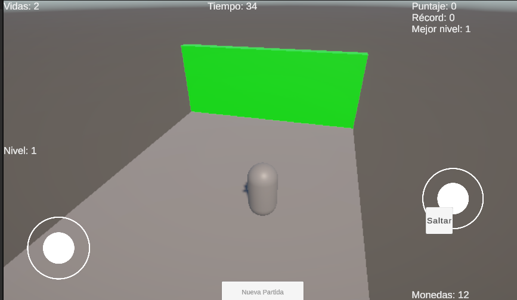
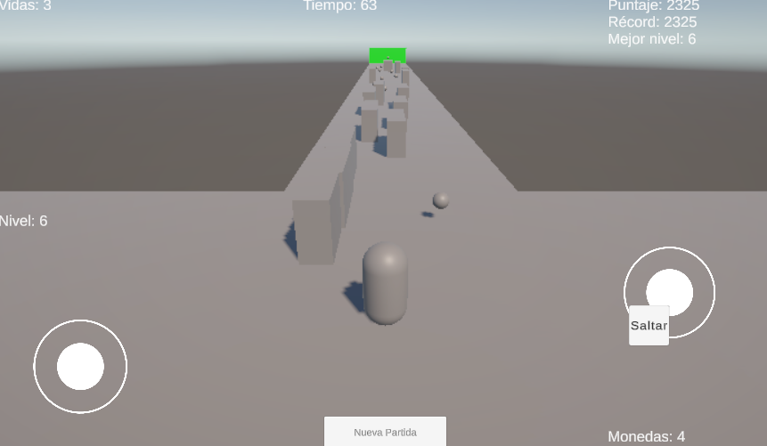

# Videojuego 3D en Unity 6

Juego 3D de plataformas y recolección hecho en **Unity 6**, con controles para **PC y móvil (Android)**, niveles generados proceduralmente, dificultad progresiva y guardado persistente con `PlayerPrefs`.

## Objetivo del juego
Llega a la **meta verde** al final de cada nivel antes de que se acabe el tiempo. Recoge monedas para sumar puntos, esquiva los obstáculos y salta los huecos. Tienes **3 vidas** por partida. Si las pierdes todas (o se acaba el tiempo), el juego vuelve al Nivel 1 con un mapa nuevo.

## Controles

| Acción | PC | Móvil |
|---|---|---|
| Moverse | W A S D / flechas | Joystick izquierdo |
| Saltar | Barra espaciadora | Botón "Saltar" |
| Girar la cámara | Click derecho + mover el mouse | Joystick derecho |
| Zoom | Rueda del mouse | - |
| Reiniciar progreso | Botón "Nueva partida" | Botón "Nueva partida" |

## Mecánicas
- **Movimiento fluido:** aceleración y frenado suaves, giro suave del personaje, caída más rápida, *coyote time* y *jump buffer* para un salto más permisivo.
- **Cámara orbital estilo MMO:** gira alrededor del personaje, con zoom y límites de ángulo y distancia. Al girarla, el personaje se alinea con ella.
- **Colisiones:** `Rigidbody` y `Capsule Collider` en el jugador, obstáculos cinemáticos, monedas y meta con *triggers*.
- **Checkpoints:** al perder una vida reapareces al inicio del módulo en el que estabas.

## Generación procedural y modular
Cada nivel se arma encadenando **módulos de 12 m** (`NivelGenerador.cs`):

- **Recto:** piso con monedas.
- **Obstáculos:** piso con obstáculos móviles que cruzan el camino.
- **Hueco:** vacío que hay que saltar, con una moneda en el aire.

El primer módulo siempre es seguro, el último contiene la **meta** y nunca aparecen dos huecos seguidos. El orden de los módulos depende de una semilla (`Random.InitState(semilla + nivel)`): el mismo nivel sale igual al reintentarlo, y cada partida nueva genera mapas distintos.

## Curva de dificultad progresiva
Una `AnimationCurve` (editable en el Inspector del `GameManager`) convierte el nivel (1 a 10) en un valor de dificultad de 0 a 1. Ese valor controla la cantidad de módulos, el ancho de los huecos, el número y la velocidad de los obstáculos y el tiempo límite.

| | Nivel 1 | Nivel 5 (aprox.) | Nivel 10 |
|---|---|---|---|
| Módulos totales | 6 | 9 | 14 |
| Ancho del hueco | 1.5 m | 2.5 m | 4 m |
| Obstáculos por módulo | 1 | 2 | 4 |
| Velocidad de obstáculos | 2 | 4 | 7 |

## Game Loop
El `GameManager` controla el flujo con cuatro estados:

```
Preparando -> Jugando -> NivelCompleto -> (siguiente nivel)
                  |
                  +----> GameOver -> reinicio en Nivel 1 con semilla nueva
```

| Transición | Qué la dispara |
|---|---|
| Preparando -> Jugando | Termina el mensaje de inicio de nivel |
| Jugando -> NivelCompleto | El jugador toca la meta |
| Jugando -> GameOver | Se pierden las 3 vidas o se acaba el tiempo |
| GameOver / NivelCompleto -> Preparando | Se recarga la escena con el nivel correspondiente |

## Sistema de guardado (PlayerPrefs)
Implementado en `SistemaGuardado.cs`. Los datos persisten al cerrar el juego.

| Clave | Qué guarda | ¿Se reinicia al perder? |
|---|---|---|
| `Nivel` | Nivel actual | Sí |
| `Puntaje` | Puntaje de la partida | Sí |
| `Semilla` | Semilla del nivel procedural | Sí |
| `MejorPuntaje` | Récord histórico | No |
| `NivelMasAlto` | Mejor nivel alcanzado | No |
| `MonedasTotales` | Monedas acumuladas | No |
| `Partidas` | Partidas perdidas | No |

Para empezar de cero, usa el botón **Nueva partida**.

## Estructura de scripts (`Assets/Scripts`)

| Script | Función |
|---|---|
| `PlayerController.cs` | Movimiento, salto y rotación del personaje |
| `CamaraSeguimiento.cs` | Cámara orbital con zoom (mouse y joystick) |
| `GameManager.cs` | Game Loop, dificultad, vidas, tiempo, puntaje y UI |
| `NivelGenerador.cs` | Generación procedural y modular de niveles |
| `SistemaGuardado.cs` | Lectura y escritura de datos con PlayerPrefs |
| `Moneda.cs` | Recolectable |
| `Obstaculo.cs` | Obstáculo móvil que quita una vida |
| `Meta.cs` | Meta que completa el nivel |

## Cómo abrir el proyecto
1. Instalar **Unity 6** desde Unity Hub.
2. Clonar o descargar este repositorio.
3. En Unity Hub: **Add > Add project from disk** y seleccionar la carpeta.
4. Abrir la escena `Assets/Scenes/[NombreDeTuEscena]` y pulsar **Play**.

## Capturas


